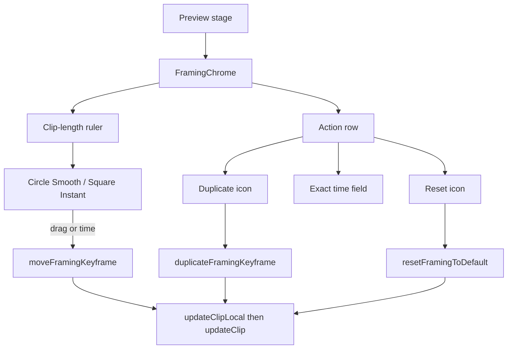

# Requirements

### Overview & Goals
Redo `FramingChrome` as a two-row mini-timeline under the preview so editors can **drag a keyframe in time**, **type its exact clip-local offset**, **see Smooth vs Instant at a glance**, **duplicate onto the playhead**, and **reset framing to default** with one icon.

Pose-on-preview (wheel / pinch / drag) and explicit **Save** stay as they are. The bar still docks **below the movie frame** (never over the Default `<video>` overlay).

### Scope
#### In Scope
- Rebuild `FramingChrome` in `PreviewPanel.kt` into:
  - an **action row** (pose readout, reset, save, duplicate, delete, Smooth/Instant, exact time field)
  - a **clip-length ruler** with draggable keyframe markers and a playhead tick
- New helpers beside the existing ones in `ClipInspector.kt`: move, duplicate, reset-to-default
- Visual interpolation: **circle = Smooth**, **square = Instant**; connector from each keyframe to the next follows that keyframe’s outgoing interpolation
- Duplicate: copy pose + interpolation onto the **playhead** when that time is free; otherwise a short offset after the source
- Reset icon: clear every keyframe and set zoom **100%** / pan **center** (50, 50)

#### Out of Scope
- Auto-key while posing on the stage (Save remains explicit)
- Drawing chrome on top of the Default DOM `<video>`
- Clip Inspector changes, FFmpeg / `framingAt` model changes, Ken Burns presets, rotation
- Framing chrome during playback or fullscreen

### User Stories
- As an editor, I want to drag a keyframe along the clip so I can retiming a push-in without deleting and re-saving.
- As an editor, I want to type `1.25` and have that keyframe land at 1.25s so I can match a beat exactly.
- As an editor, I want Smooth keyframes to look like circles and Instant like squares so I can read the envelope without toggling.
- As an editor, I want a reset icon that restores default framing in one click so I can start over.
- As an editor, I want Duplicate to drop a copy at the playhead (or just after the original) so I can drag the copy into place.

### Functional Requirements
- **Layout:** two rows, still inside the rounded preview box, below the aspect stage, above transport. Hidden while playing, fullscreen, or when the selection is not a framable image/video clip.
- **Ruler domain:** `[0, clipLength]` in clip-local seconds. Playhead tick uses the same red as the volume editor (`0xFFFF5A6E`). Clicking a marker selects it and seeks (`allowPastEnd = true`, same as today’s chips). Clicking empty ruler seeks within the clip; it does **not** add a keyframe.
- **Drag:** horizontal only. Live preview via `updateClipLocal` + seek to the dragged time; persist with `updateClip` on pointer up. Two keyframes may not share a hit window (`FRAMING_KEYFRAME_HIT_SECONDS` = 0.08); dropping onto another **nudges** just outside rather than merging/deleting.
- **Exact time:** when a keyframe is selected, the action row shows a compact seconds field (not `StudioTextField` — too tall / AI chrome). Enter / focus-loss runs the same move helper as drag. Clamp to `[0, clipLength]`.
- **Duplicate:** enabled when a keyframe is selected (`nearby`). Target = playhead if it is inside the clip **and** not within 0.08s of any existing keyframe; else `source.time + 0.25s`, then step forward (then backward) until free. Seek to the copy.
- **Reset:** `RoundIconButton` `↺`. Clears `framingKeyframes`, sets `zoom = 1.0`, `offsetX/Y = 50`, clears `framingDraft`. Disabled when already default.
- **Save / Delete / Smooth / Instant / pose numbers dialog:** keep current behavior, now targeting the selected / nearby keyframe.
- User-facing copy says **Movie**, never Film. Clickable controls **clip to shape** before `clickable` / pointer input.

### Non-Functional Requirements
- Drag must not hit the network every pointer move (`updateClipLocal` during drag, `updateClip` on end).
- Chrome stays below the stage so Default `<video>` overlay bounds stay aligned.
- Extra height is acceptable (~32dp actions + ~28dp ruler) because the mini-timeline needs a time scale.

# Technical Design

### Current Implementation
`FramingChrome` (`PreviewPanel.kt` ~356–457) is a 36dp horizontally scrolling chip row: zoom/pan chips → Save / Delete → Smooth / Instant → one time chip per keyframe (click seeks). Helpers live in `ClipInspector.kt`:
- `upsertFramingKeyframe` / `deleteNearestFramingKeyframe` / `setFramingKeyframeInterpolation`
- `nearestFramingKeyframe` (hit radius 0.08s)
- `clipLocalPlayheadSeconds`

There is **no** move or duplicate helper. `FramingPoint` has no id — identity is `time`. Gestures already use `updateClipLocal` then `updateClip` (`AppViewModel`). The volume editor (`VolumeEnvelopeDialog`) is the drag-keyframe reference: `detectDragGestures` + hit-test, but it auto-creates points on empty-canvas drag — framing must **not** do that (Save stays explicit).

Default pose is `EffectsConfig` defaults: `zoom = 1.0`, `offsetX/Y = 50.0`, empty `framingKeyframes`.

### Key Decisions
- **Mini-timeline, not chips.** Time-scaled ruler is the only layout that makes drag and “see Smooth vs Instant” honest. Height grows; chrome still docks below the stage.
- **Circle = Smooth, square = Instant.** Outgoing connector is solid (Smooth) vs stepped/dashed (Instant). Smooth/Instant toggle chips remain for the selected keyframe.
- **Duplicate at playhead if free**, else +0.25s (then search). Matches “duplicate then move”.
- **Reset is full default**, not “clear keys keep pose”. Also `clearFramingDraft()`.
- **Selection stays playhead-hit** (`nearby`), plus the in-flight dragged point. No new selected-id on `FramingPoint`.
- **Collision = nudge, not merge.** Accidental drop must not delete a neighbor.
- **Exact time is a compact field**, not `StudioTextField` (label + AI button won’t fit a 32dp row). Reuse `parseFramingNumber` style parsing.

### Proposed Changes
Rebuild `FramingChrome` as a `Column` of two rows. Keep `FramingNumberChip`, `FramingNumbersDialog`, `FramingChromeDivider`, Save / Delete / interpolation wiring.

**Action row (~32dp)**
- Pose chips (open existing numbers dialog)
- `RoundIconButton("↻", contentDescription = "Reset framing")` → `resetFramingToDefault`
- Save (unchanged upsert at playhead)
- `RoundIconButton` duplicate (e.g. `⎙`) → `duplicateFramingKeyframe` + seek
- Delete (unchanged)
- Smooth / Instant toggles (unchanged, need `nearby`)
- Compact time field when `nearby != null`

**Ruler row (~28dp)**
- `BoxWithConstraints` track, `clip` to a rounded rect, dark fill like today’s chrome (`0xFF1A1620`)
- Playhead tick at `(playhead - timelineStart) / clipLength`
- One marker per keyframe at `time / clipLength`:
  - `CircleShape` vs `RoundedCornerShape(2.dp)` square, ~12dp, **clip before** pointer input
  - selected / nearby = `primary`, else muted
- Connector canvas behind markers, styled by each point’s `interpolation`
- Click marker → seek; drag → `moveFramingKeyframe` via local then persist

During drag, apply moved times with `updateClipLocal` **and** `seek(clip.timelineStart + draggedTime, allowPastEnd = true)` so the stage shows that keyframe’s pose, not the old lerp at the new time. On end, `updateClip`.



### Data Models / Contracts
No serialization change. New helpers in `ClipInspector.kt`:

```kotlin
internal const val FRAMING_DUPLICATE_OFFSET_SECONDS = 0.25

internal fun moveFramingKeyframe(
    effects: EffectsConfig,
    fromTime: Double,
    toTime: Double,
    clipLength: Double,
    hitSeconds: Double = FRAMING_KEYFRAME_HIT_SECONDS,
): EffectsConfig

internal fun duplicateFramingKeyframe(
    effects: EffectsConfig,
    sourceTime: Double,
    preferredTime: Double?, // playhead in clip, or null if outside
    clipLength: Double,
    hitSeconds: Double = FRAMING_KEYFRAME_HIT_SECONDS,
): Pair<EffectsConfig, Double>?

internal fun resetFramingToDefault(effects: EffectsConfig): EffectsConfig

internal fun isDefaultFraming(effects: EffectsConfig): Boolean

internal fun nextFreeFramingTime(
    keyframes: List<FramingPoint>,
    preferred: Double,
    clipLength: Double,
    hitSeconds: Double = FRAMING_KEYFRAME_HIT_SECONDS,
): Double?
```

- `moveFramingKeyframe`: resolve source by nearest-hit; clamp `toTime` to `[0, clipLength]`; if another point occupies the hit window, nudge with `nextFreeFramingTime` in the move direction; keep pose + interpolation; re-sort by time.
- `duplicateFramingKeyframe`: copy pose + interpolation; prefer `preferredTime` when in range and free, else `source + 0.25` then search; `null` if no slot.
- `resetFramingToDefault`: `copy(zoom = 1.0, offsetX = 50.0, offsetY = 50.0, framingKeyframes = emptyList())`.
- Time field parse: trim, optional `s` suffix, `toDoubleOrNull()` — same spirit as `parseFramingNumber`.

### File Structure
- **Modify** `app/shared/src/commonMain/kotlin/app/moviestudio/ui/PreviewPanel.kt` — rewrite `FramingChrome`; add `FramingKeyframeRuler` / marker composables; compact time field
- **Modify** `app/shared/src/commonMain/kotlin/app/moviestudio/ui/ClipInspector.kt` — add move / duplicate / reset / free-time helpers
- **Modify** `app/shared/src/commonTest/kotlin/app/moviestudio/SharedCommonTest.kt` — tests for those helpers
- Reuse `RoundIconButton` in `Components.kt` (no new button primitive)

### Risks
- **Default `<video>` overlay:** chrome must remain below the inner stage (already true; don’t overlay markers on the frame).
- **Identity is time:** while dragging, track the original `fromTime` (or the in-flight point) so hit-tests don’t snap to a neighbor mid-gesture.
- **Packed keyframes:** duplicate/move can fail to find a free slot on a very short clip — disable Duplicate / ignore the move rather than stacking.
- **Preview during drag:** seeking without `updateClipLocal` would show the old interpolation at the new time; both are required.

# Testing

### Validation Approach
Unit-test the new helpers in `SharedCommonTest.kt` next to the existing upsert/delete/hit-radius cases. There is no Compose UI test framework; chrome behavior is checked by the scenarios below during implementation.

### Key Scenarios
- Move a keyframe from 1.0s to 2.5s on a 5s clip: time updates, pose/interpolation preserved, list stays sorted.
- Type `1.25` on the selected keyframe: same result as move to 1.25s; playhead seeks there.
- Duplicate with playhead in a free gap: copy appears at the playhead with the same pose and interpolation.
- Duplicate with playhead on the source: copy lands at `source + 0.25` (or the next free slot).
- Reset on a clip with keys + custom zoom: empty keyframes, zoom 1.0, pan 50/50, draft cleared.
- Ruler: Smooth points render as circles, Instant as squares; selected marker matches `nearby`; playhead tick tracks scrubbing.
- Drag a marker: preview shows that keyframe’s pose while dragging; one persist on pointer up.

### Edge Cases
- Move/type outside `[0, clipLength]` clamps.
- Drop onto another keyframe nudges instead of deleting it.
- Duplicate returns `null` / button disabled when no free slot remains.
- Reset disabled when already default; Save still disabled when playhead is outside the clip.
- Chrome hidden while playing, fullscreen, and for text/description clips.
- Unsorted input to move/duplicate comes out sorted (same as upsert).

### Test Changes
Add in `SharedCommonTest.kt`:
- `moveFramingKeyframeRelocatesAndKeepsPose`
- `moveFramingKeyframeClampsAndNudgesOffNeighbor`
- `duplicateFramingKeyframePrefersPlayheadWhenFree`
- `duplicateFramingKeyframeFallsBackToOffsetWhenPlayheadOccupied`
- `resetFramingToDefaultClearsKeysAndStaticPose`
- `isDefaultFramingDetectsUntouchedClip`

Keep existing upsert / delete-last / hit-radius tests.

# Delivery Steps

### ✓ Step 1: Add move, duplicate, and reset helpers with tests
ClipInspector.kt can relocate, copy, and fully reset framing keyframes; SharedCommonTest.kt covers the new contracts.

- Add `FRAMING_DUPLICATE_OFFSET_SECONDS` (0.25) next to `FRAMING_KEYFRAME_HIT_SECONDS` in `ClipInspector.kt`.
- Implement `nextFreeFramingTime`, `moveFramingKeyframe` (clamp to clip, nudge off neighbors, keep pose + interpolation, re-sort), `duplicateFramingKeyframe` (prefer playhead if free, else +0.25 search), `resetFramingToDefault`, and `isDefaultFraming`.
- Do not change `FramingPoint` / `EffectsConfig` serialization.
- Add the helper tests listed in Testing to `SharedCommonTest.kt`; leave existing upsert/delete tests untouched.

### ✓ Step 2: Rebuild FramingChrome as a two-row mini-timeline
The preview chrome is a two-row bar: actions on top, a clip-length ruler with circle/square markers below — still docked under the stage.

- Replace the 36dp scrolling chip row in `PreviewPanel.kt` `FramingChrome` with a `Column`: ~32dp action row + ~28dp ruler.
- Action row: existing pose chips + numbers dialog, `RoundIconButton` reset (`↻`), Save, duplicate icon, Delete, Smooth/Instant toggles, compact exact-time field when `nearby != null`.
- Ruler: `BoxWithConstraints` track over `[0, clipLength]`, red playhead tick, connectors styled by outgoing interpolation, circle (Smooth) / square (Instant) markers clipped before pointer input.
- Click marker still seeks (`allowPastEnd = true`). Click empty ruler seeks inside the clip; it does not add a keyframe.
- Wire Reset / Duplicate / time-field submit to the new helpers and `viewModel.updateClipEffects` / `seek` / `clearFramingDraft`. Disable reset when `isDefaultFraming`, duplicate when nothing is selected or no free slot.

### ✓ Step 3: Make keyframe markers draggable with live preview
Dragging a ruler marker retimes that keyframe; the preview follows, and the change persists on pointer up.

- Hit-test markers (same idea as `volumePointNear`) and `detectDragGestures` horizontally only — do not create keyframes on empty-track drag.
- While dragging: `moveFramingKeyframe` through `updateClipLocal`, seek to the in-flight time so the stage shows that keyframe’s pose, keep the dragged point selected even if it leaves the 0.08s hit window.
- On drag end: `updateClip` once. If the drop sits on a neighbor, nudge via `nextFreeFramingTime` rather than merging.
- Confirm chrome still hides during playback/fullscreen, stays below the stage (Default `<video>` overlay aligned), and every new clickable control clips to its shape.